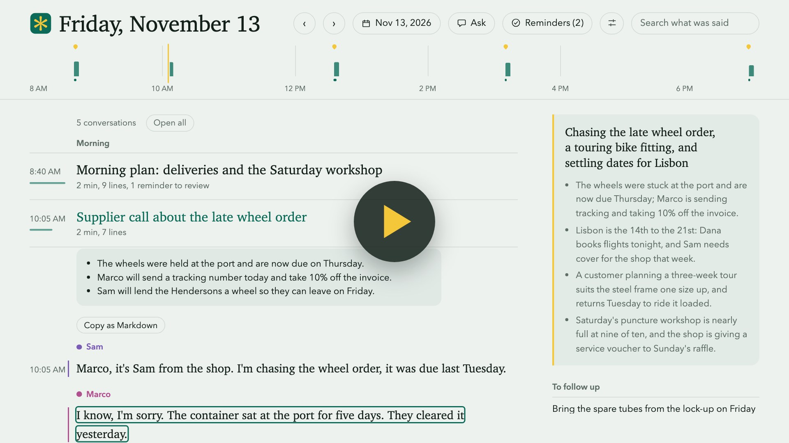
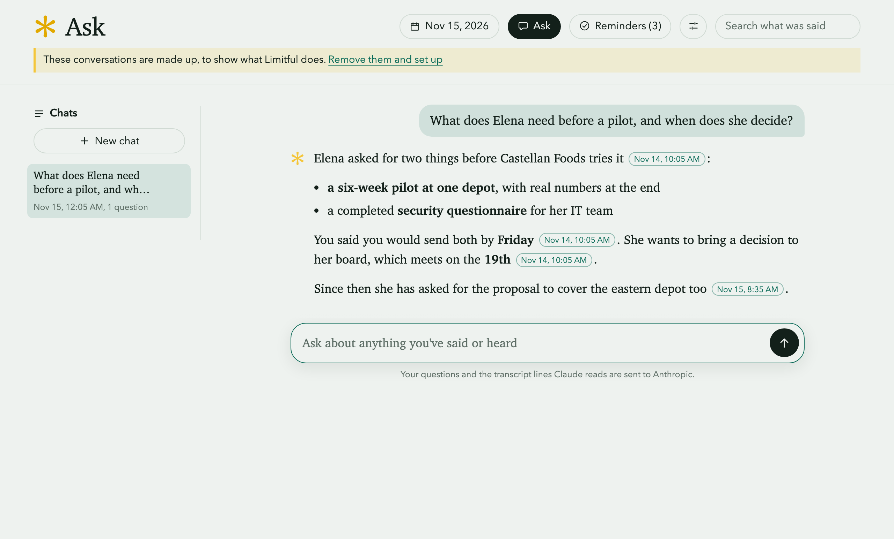
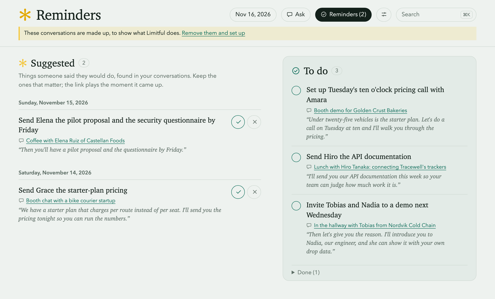

<p align="center"></p>

# Limitful

An open-source replacement for the Limitless app, for people who want to keep
using their Limitless Pendant. It pulls recordings off the pendant over
Bluetooth, transcribes them on your computer, and gives you a Lifelog to read,
search, listen to and ask questions of. No Limitless account or server is
involved.

Limitless ends its service on December 1, 2026 and deletes the data it holds.
This project exists so the hardware keeps working after that, and so the
history you export before then stays usable.

## What it does

- **Syncs the pendant** over Bluetooth, from the command line, in the
  background, or with a button in the app.
- **Transcribes on your machine** with Whisper. Audio stays on your computer
  unless you choose a hosted service.
- **Lifelog web app**: each day as a list of conversations, with playback from
  any line, a timeline of the day, and search across everything, by exact
  words or (once set up) by meaning.
- **Summaries and reminders**: a title and summary for each conversation, and
  suggested reminders linked to the line they came from. Uses Claude or a local
  Ollama model, and is off until you choose one.
- **Ask**: questions about what was said, answered with links to the lines
  that support the answer.
- **Imports your Limitless export**: transcripts, audio and reminders.
- **Pendant controls**: battery and storage, light brightness, pause, pair and
  unpair.

<p align="center"><a href="assets/promo/limitful-promo.mp4"></a></p>

<p align="center"><a href="assets/promo/limitful-promo.mp4">Watch the 73-second video</a> (silent, with captions; <a href="assets/promo/README.md">how it is made</a>)</p>

| Ask, with links to the lines behind the answer | Reminders, found in what was said |
|---|---|
|  |  |

The conversations in these pictures are made up; see
[Try it without a pendant](#try-it-without-a-pendant).

**Status: early, but working.** The whole path, from pendant to transcript to
Lifelog, runs daily against one real pendant on macOS. It has not been tested
on Linux or Windows. What has not been verified is listed under
[Not yet verified](#not-yet-verified).

## Install

Requires Python 3.10+ and [uv](https://docs.astral.sh/uv/).

```sh
git clone https://github.com/andreibondarev/limitful.git
cd limitful
uv sync
```

### Try it without a pendant

```sh
uv run limitful demo
uv run limitful serve --data-dir ~/Limitful-demo
```

`demo` writes a folder of made-up conversations (a bike shop, over three
days) with summaries, reminders, a day's recap and a saved question. The
lines have no audio, so they can be read, searched and asked about but not
played. It will not write into a folder that already has conversations.

## Use

The quickest way in is the app itself:

```sh
uv run limitful serve
```

The first time, with nothing recorded yet, it opens a setup guide that walks
through connecting the pendant (what to do before pairing, the button press,
the first sync and its one-off 1.6 GB speech model download) and choosing
what writes summaries. It can also import a Limitless export or load made-up
conversations to look around. Every step can be skipped, and Settings has
"Set up again". The commands below do the same things from a terminal.

The pendant only advertises when no other device is connected to it, so turn
off Bluetooth on your phone (or quit the Limitless app) first.

The first time, run `pair` and put the pendant in pairing mode: press and
release the button, then immediately press and hold until the purple light goes
out, and release. A blue light means it is ready to pair. Accept the connection request your computer shows. **Pairing mode
resets the pendant and clears the audio stored on it**, so let the Limitless app
sync first if you still use it.

```sh
uv run limitful scan      # find the pendant
uv run limitful pair      # first use only: pair this computer with it
uv run limitful status    # how much audio is stored on it
uv run limitful sync      # download everything into ~/Limitful
uv run limitful transcribe  # turn new audio into text, on this machine
```

Transcripts are written to `transcripts/<date>.md`, one timestamped line
per utterance. Transcription uses Whisper (`large-v3-turbo`) locally; the model
is about 1.6 GB and downloads on first use. No audio leaves your computer,
unless you choose a hosted service (see Speaker labels).

Everything is stored in `~/Limitful` (change it with `--data-dir` or the
`LIMITFUL_DATA` environment variable). Audio lands in
`audio/<date>/<time>.ogg` (Ogg Opus, plays in VLC, ffmpeg and most browsers).
The raw pages from the pendant are kept in `pendant.db`, so audio can be
re-exported later with `uv run limitful export`.

On macOS the first run asks for Bluetooth permission for your terminal app.

### Reading and listening

```sh
uv run limitful serve
```

Opens the Lifelog at http://localhost:4747. Each day is a list of
conversations with their time, title and length, under a strip showing when
speech happened; click the strip to jump to that moment. Open a conversation
to read it under its section headings, click any line to hear it (playback
carries on through the conversation, with a timeline to jump around in), or
copy it as Markdown. Each speaker in a conversation has a colour, stray
words with no conversation around them fold into one quiet row, and on a wide
screen the day's recap, open reminders and named people sit beside the list.
Search covers every day. The page only answers on
your own machine. Recordings are Ogg Opus, which Chrome and Firefox play;
older versions of Safari do not.

### Summaries and reminders

Recordings are grouped into conversations (five minutes of silence ends one).
A language model can then give each a title and a short summary, and suggest
reminders for things someone said they would do. This is off until you choose
what writes them, under Settings, Summaries:

- **Claude**: paste an Anthropic API key. The text of each conversation is
  sent to Anthropic; audio is not.
- **Ollama**: a model running on your own machine (`llama3.1` by default), so
  nothing leaves it.

New conversations are summarised after each sync. `uv run limitful digest`
does it by hand, and `--redo` writes them all again.

Each day also gets a recap at the top of its page: one sentence on what the
day was about, then its main threads. It is written from the titles and
summaries of that day's conversations, not from the transcripts, once the day
is over and it has at least two summarised conversations. For today, or for
days imported from Limitless, click "Write a recap of this day"; imported days
are not sent anywhere until you do. `uv run limitful digest --days` writes a
recap for every finished day that lacks one, imported history included.

The Reminders page shows suggestions grouped by day, each with a link that
plays the moment it came up. Keep one and it moves to your to-do list; tick it
off when it is done.

### Ask

The Ask page answers questions such as "what did the dentist say about the
crown?" by searching and reading your transcripts. Answers cite the lines they
rest on, and each citation opens that line. Chats are saved. From the command
line: `uv run limitful ask "..."`.

Ask needs Claude, with the key saved in Settings. The lines it reads to answer
a question are sent to Anthropic.

### Bringing your Limitless history

Request a data export from Limitless before December 1, 2026, then import the
zip from Settings, Import, or with:

```sh
uv run limitful import data-export.zip
```

Transcripts, section headings, audio and reminders are imported, and
importing the same export twice adds nothing. Speakers keep Limitless's
"Speaker 1", "Speaker 2" within each conversation. Chats in the export are not
imported yet.

Lines in a Limitless transcript often sit a few seconds away from where they
are heard. `uv run limitful retime` listens to the imported audio with Whisper
and moves each line to where its words are; `--minutes 60` does it in
stages and `--undo` puts everything back. It takes roughly a fifth of the
audio's length on a laptop CPU, and nearer a third when the laptop is busy.

The same job runs from Settings, under **Timing of imported lines**, which
shows how many recordings and hours are left. Progress shows at the top of the
page, the page stays usable, and nothing else (a sync, an import) can start
until it finishes. **Stop** lets the recording in hand finish, then stops;
starting again carries on with the rest.

### What leaves your computer

Nothing, by default. Syncing, transcription, search and playback are local.
Three things send data out, and each is off until you turn it on in Settings:

| If you choose | What is sent | To |
|---|---|---|
| Claude for summaries | The text of each conversation; for a day's recap, that day's titles and summaries | Anthropic |
| Ask | The lines it looks up to answer | Anthropic |
| Deepgram for transcription | The audio of new recordings | Deepgram |

API keys are kept in `~/.config/limitful/config.json`, readable only by you,
outside the data folder, and are never sent back to the page.

### Search by meaning

The search box and Ask match words exactly. Search by meaning also finds lines
that say the same thing in other words: asking about a "massage for the lymph
system" finds the talk about lymphatic drainage. It is off until you set it
up, in Settings under **Search by meaning** or with:

```sh
uv run limitful index                       # build it, or add what is new
uv run limitful index --find "heat cabin"   # try it from the terminal
uv run limitful index --remove              # delete it; transcripts are untouched
```

It runs on this computer. A small model (34 MB, downloaded once and checked
against a pinned checksum) turns each line, together with the two lines either
side of it, into a list of numbers; these are kept in `search.db` next to
`pendant.db`, 26 MB for 31,750 lines. Building it for those lines took 9
minutes on one run and 23 on another, on a laptop busy with other work both
times; a search then takes about a fiftieth of a second. It can be stopped and carries
on where it left off, and once it exists new lines are added as they are
transcribed. After importing an export, run it again (or press the button) to
add the imported lines.

Once the index exists:

- **Ask** gets a second way to look things up and is told when to use it.
- **The search box** lists exact matches first, exactly as before, and under
  them up to eight moments that are close in meaning.

What was measured, on one person's 31,750 lines, with 15 questions worded to
avoid the words actually spoken (so this is the case it is meant for, not a
typical search), counting a hit when a result was on or within three lines of
the line holding the answer:

| Method | In the top 5 | Top 10 | Top 40 |
|---|---|---|---|
| Word matching, as Ask used before | 0 | 2 | 3 |
| Meaning, each line on its own | 6 | 9 | 12 |
| Meaning, each line with its neighbours (what is used) | 8 | 9 | 14 |

Neighbouring lines come back in clumps, so what is shown is one line per
moment. Counted that way, the answer was among the eight moments the search
box shows for 10 of the 15 questions, and among the thirty Ask is given for
all 15. Fifteen questions written by the person who built the feature, on one
person's recordings, is a small and friendly sample.

Limits worth knowing. It always returns its closest lines, related or not, and
the closeness score does not tell the two apart: right answers scored 0.57 to
0.79 and the unrelated lines beside them a median of 0.68. That is why the
search box keeps these results separate and labelled instead of mixing them
in. For names, numbers and exact phrases, word matching is still better. The
model is English-only.

### The pendant, from the app

The Lifelog's Settings page has a Pendant section:

- **Check pendant** reads its battery level, how much audio is waiting and how
  much room is left.
- **Sync now** does what `watch` does, once: downloads new audio, frees it on
  the pendant, then transcribes and summarises it, with progress shown.
- **Light** sets the brightness of the pendant's light, from off to 100%. The
  pendant does not report its brightness, so the slider shows the last value
  set from here.

From the command line, `uv run limitful status` shows the same readings and
`--brightness 40` sets the light.

With the pendant plugged in by USB cable, the section also shows its firmware
version, battery voltage and temperature, and the light slider shows the
pendant's real brightness. These are read over the pendant's USB shell, using
three read-only commands and nothing else.

- **Pause** stops the app keeping audio. The pendant itself cannot be told to
  stop recording (no such command is known, and its live-stream mode keeps
  writing to storage, which was measured). So a pause is kept by the app: the
  pendant goes on recording, and anything from the paused period is deleted
  when it syncs, without being stored or transcribed. A Paused marker shows on
  every page until you resume. To stop the pendant recording at all, hold its
  button for two seconds to switch it off.
- **Pairing** has two buttons. Pair this computer waits three minutes while
  you put the pendant in pairing mode. Unpair makes the pendant forget this
  computer so another can pair with it, keeping its recordings.

On the command line: `limitful pause`, `limitful resume`, `limitful pair` and
`limitful unpair`.

The Bluetooth unpair command has only been tested against a simulated
pendant. Unpairing over USB has been done on a real one: see below.

#### Moving a pendant to another computer without erasing it

Pairing mode is a factory reset, but it is only needed because the pendant
refuses new computers while it remembers an old one. With a USB cable it can
be told to forget, and then it pairs like new and keeps its audio. This was
done on a real pendant (firmware 1.1.20), and the 1,400 pages stored on it
survived:

1. Plug the pendant in and type `ble unpair` into its USB shell (see Hardware
   notes; 115200 baud). The pendant forgets every computer and phone.
2. On a computer that was paired with it before, remove Pendant under
   Bluetooth in System Settings, then turn Bluetooth off and on. Without this
   the computer keeps trying its old key and cannot connect at all. A computer
   that has never seen the pendant should not need this step; that case was
   not tried.
3. Run `uv run limitful pair` and accept the connection request. No button
   press on the pendant is needed.

Limitful does not send `ble unpair` for you yet.

### Speaker labels

Automatic speaker labels are **off by default**, because nothing tested so far
works on real pendant recordings.

What was measured, on ten imported conversations, as the share of speaking
time given to the same speaker Limitless gave it to (always guessing the main
speaker scores 63%):

| Method | Score |
|---|---|
| Separation model (pyannote segmentation with five different voice models), told the number of speakers | 62% |
| The same, deciding the number of speakers itself | 28% to 49% |
| Grouping transcript lines by voice fingerprint | 30% to 49% |
| Claude reading the words alone | 58% |

The same separation pipeline splits a clean two-speaker test recording
correctly, so the difficulty is the audio: one microphone, worn, with people
at different distances. Limitless's labels are also not a clean reference: in
43% of conversations, lines it gives to one speaker sound no more alike than
lines it gives to different speakers.

What does work:

- Imported conversations keep Limitless's per-conversation "Speaker 1",
  "Speaker 2". Click one to name that speaker in that conversation.
- Click a named speaker to rename that person everywhere; giving two speakers
  the same name merges them. "Only this conversation" changes one conversation.
- `uv run limitful speakers` lists speakers; `--rename 2 Andrei` names one.

Telling which speaker is you, by loudness, was also measured and does not
work. The idea: the pendant is worn, so its wearer should be the loudest voice
in every conversation. In the six imported conversations where one speaker is
named as the wearer, the wearer was the loudest speaker in three (chance
would be 2.6 of six), and never by more than half a decibel either way. Across
twenty other conversations the loudest speaker led the next by a median of
1.7 dB, and by under 1 dB in 30% of them. The pendant appears to even out
loudness, so nothing was built on it. Six conversations is a small sample, and
some of those names may have come from the unreliable voice linking.

#### Speaker labels from a hosted service (opt-in, measured: not better)

A hosted transcription service can label speakers where local methods could
not. Limitful can use [Deepgram](https://deepgram.com) in place of local
Whisper for new recordings from the pendant:

- Choose it under Settings, Transcription, and paste a Deepgram API key, or
  run `uv run limitful transcribe --engine deepgram` once a key is saved.
- **The audio of every new recording is then sent to Deepgram and billed to
  your Deepgram account.** Nothing is sent until you choose this. The key is
  kept in `~/.config/limitful/config.json`, readable only by you, and is never
  shown again.
- A service's "Speaker 1" only means something within one request, and the
  pendant splits a conversation into many short recordings. So recordings are
  grouped into conversations (a five-minute silence ends one), joined, and sent
  as one piece. The newest conversation waits until it has been quiet for five
  minutes, so text appears a little later than with local transcription.
- Lines arrive as "Speaker 1", "Speaker 2" within each conversation. Click one
  to name that speaker in that conversation, exactly as with imported ones.
- Imported conversations are never sent; they keep Limitless's transcript.

**Measured against the real service, its speaker labels are no better than
guessing.** Five imported conversations were sent to Deepgram (nova-3) and
its speakers compared with Limitless's, as the share of speaking time given to
the same speaker:

| Conversation | Limitless's speakers | Deepgram found | Score | Always guessing the main speaker |
|---|---|---|---|---|
| 1 | 3 | 2 | 59% | 57% |
| 2 | 2 | 1 | 48% | 64% |
| 3 | 3 | 1 | 18% | 64% |
| 4 | 3 | 2 | 45% | 55% |
| 5 | 3 | 3 | 48% | 45% |
| Average | | | 44% | 57% |

It found fewer speakers than Limitless in four of the five, and on a pendant
recording of one voice repeating a test phrase it found two. The score also
counts speech Deepgram did not transcribe as wrong, which is why finding one
speaker can score below the baseline, so read it as "not better", not as a
precise figure. Five conversations is a small sample, and Limitless's labels
are themselves an imperfect reference.

What was confirmed: Deepgram accepts both WAV and the pendant's Ogg Opus
(`audio/ogg`), saved keys are checked and accepted, and each line comes back
with a speaker. Not seen yet: what a refused key or exhausted credit looks
like in practice (assumed: HTTP 401 or 403, and 402).

To repeat the measurement, at your own cost:

```sh
uv run limitful score-speakers --limit 5
```

sends up to five imported conversations (two to four speakers, under twenty
minutes each) to Deepgram and prints, for each, the share of speaking time it
gave to the same speaker Limitless did, next to the score for always guessing
the main speaker. On the conversations used for the table above that baseline
was 63%; a service worth switching to should beat it clearly.

The experimental voice labelling is still there for anyone who wants to try
it: `limitful transcribe --speakers`, `limitful watch --speakers`, and
`limitful speakers --link-imported` for imported conversations.

### Transcription on the Apple GPU: tried, not the default

Local Whisper runs on the CPU. The library underneath (CTranslate2 4.9) has an
experimental Apple GPU mode, `--device mps`, which was measured on an M-series
laptop to see whether it should be the default. It should not, yet:

- **It fails at random.** Of six runs of the same test, three failed on every
  recording they were given (46 attempts in all), each time with an error
  from the library (`IndexError: vector`, or with full-precision numbers
  `Invalid token ID 18446744073709551615`). The other three ran the same
  recordings 53 times with no failure. A run that started 22 seconds after a
  failed one worked. Nothing that was varied (number precision, word timings,
  a fixed language) made the difference.
- **When it works it is quick and about as good.** On five recordings of real
  speech (17 minutes) it ran at 9 to 13 times real time, against 3 times for
  the CPU. Both were measured while the laptop was busy with other work, so
  read the ratio and not the absolute numbers. Its text matched Limitless's
  transcript of the same recordings as well as the CPU's did (a similarity of
  0.61 against 0.59, where 1 is identical), and empty files and recordings
  with no speech gave no lines on either. How well its word timings agree with
  the CPU's was not measured: the run meant to compare them was one that
  failed.

So the default stays on the CPU, and `--device mps` stays available on
`transcribe`, `watch` and `retime` for anyone who wants to try it; if it
fails, run the command again. The cause was not found. The laptop's GPU was
shared with other programs during the test, which may matter.

### Keeping "mhm" and "uh": tried, nothing adopted

Local Whisper leaves out most filler words that Limitless's transcripts keep.
Seven combinations of Whisper settings were tried to get them back, scored
against Limitless's own text for the same audio. The rule was to adopt a
setting only if it kept more fillers without inventing lines on silent audio,
which is the fault the current settings were chosen to stop.

First, on five imported recordings picked for having the most fillers (14
minutes, 67 filler words in Limitless's text) and twelve pendant recordings
with nobody speaking (3 minutes):

| Setting | Fillers kept, of 67 | Lines invented on the silent recordings |
|---|---|---|
| As shipped | 22 | 0 |
| Start each file with a prompt full of fillers | 30 | 1 ("Mm-hmm.") |
| Suppress no tokens | 22 | 0 |
| Looser speech detector | 33 | 3 ("Thank you." twice, and a line of Russian) |
| Carry the previous text forward | 50 | 0 |
| Prompt and looser detector | 29 | 3 |
| Prompt and carry the previous text | 62 | 1 ("Mm-hmm.") |

Loosening or removing the confidence filter kept no more fillers under any
setting and let a "Thank you." through on silence. The prompt and the looser
detector both bring invented lines back, so they are out.

Carrying the previous text forward looked like the answer, so it was run again
on recordings not chosen for their fillers. It did not hold up:

| | As shipped | Carrying text forward |
|---|---|---|
| Nine other imported recordings (22 minutes): fillers kept, of 30 | 8 | 8 |
| 21 of the pendant's own recordings with speech (12 minutes) | 374 words, no fillers | the same text in 20 of them, no fillers |
| 60 pendant recordings with nobody speaking (28 minutes): lines invented | 0 | 0 |

It did no harm in that run, but it gained nothing either, and the pendant's
own recordings are mostly under half a minute, where this setting cannot act
at all. One good result on hand-picked recordings is not enough to change a
setting that was turned off for making wrong guesses repeat, so the settings
are unchanged.

Caveats: fillers were counted, not matched one by one in time; the samples are
small and from one person's recordings; and Limitless's text is not a perfect
reference. One-word lines such as "Mhm." or "Yeah." could not be judged: the
sample held only four such words, and every setting kept all four.

### Running in the background

On macOS, Limitful can start when you log in and keep the pendant synced with
no terminal open. Switch it on under Settings, Pendant, or:

```sh
uv run limitful autostart on      # off, or status
```

This adds a login item (`~/Library/LaunchAgents/dev.limitful.app.plist`) that
runs the Lifelog with `--sync-every 120`: every two minutes it looks for the
pendant and, when it is in reach, downloads new audio, frees it on the pendant,
and transcribes and summarises it. A pendant that is away is not an error. Its
log is `limitful.log` in the data folder. Switched on from the app, it takes
effect at your next login, and the app you have open starts syncing by itself
straight away. The first time, macOS may ask whether Python can use Bluetooth.

On other systems, or to do the same by hand:

```sh
uv run limitful watch
```

`watch` checks for the pendant every two minutes. When it is in range it
downloads new audio, frees that audio on the pendant, and transcribes it. Leave
it running in a terminal. Use `--keep` to leave audio on the pendant and
`--no-transcribe` to download only. `limitful serve --sync-every 120` does the
same from inside the Lifelog.

### Freeing space on the pendant

By default `sync` is read-only: the pendant keeps its copy and will send the
same pages again next time (they are skipped locally).

```sh
uv run limitful sync --ack
```

`--ack` tells the pendant to delete pages once they are safely on disk. After
that your computer holds the only copy, so back up the data folder.

## How it works

- `protocol.py`: the wire format (protobuf-style messages over one BLE service).
- `client.py`: connect, set the clock, read storage status, download pages.
- `usb.py`: read-only readings over the pendant's USB shell.
- `store.py`: the SQLite store: raw pages, recordings, lines, conversations,
  reminders and chats.
- `ogg.py`: a small Ogg Opus writer.
- `transcribe.py`: speech-to-text engines (local Whisper by default).
- `hosted.py`: hosted transcription with speaker labels (Deepgram).
- `scoring.py`: scoring a service's speaker labels against Limitless's.
- `speakers.py`: voice fingerprints for speaker labels.
- `digest.py`: titles, summaries and reminders from a language model.
- `ask.py`: question answering over the transcripts, with citations.
- `search.py`: search by meaning: the local model and its index.
- `upkeep.py`: long jobs the Lifelog can start and stop (re-timing, indexing).
- `config.py`: saved settings, including the API key.
- `importer.py`: import of a Limitless data export.
- `demo.py`: the made-up data folder.
- `watch.py`: the background loop.
- `autostart.py`: the macOS login item.
- `web.py` and `web/index.html`: the Lifelog web app.

## Using the pendant without the Limitless app

Summarised from Limitless's help centre, which is due to go offline with the
service. The pendant has one button, on its side, and one light.

- **Power on or off:** hold the button for two seconds.
- **Mark a moment:** one quick press.
- **Factory reset and pairing mode:** press and release, then immediately press
  and hold. A purple light appears; keep holding until it goes out, then
  release. A blue light means it is ready to pair. This deletes any recordings
  not yet synced.
- **Solid red light (recovery mode):** hold the button for ten seconds or more
  until the light goes out.
- **Charging:** any standard USB-C charger, but not a Power Delivery (PD)
  charger. It keeps recording while it charges.

Light colours: blue is ready to pair, purple is a factory reset in progress,
solid red is recovery mode, blinking or breathing red is an error. White,
orange and green indicate recording and charging states.

## Hardware notes

Observed on one pendant; treat as provisional.

- Firmware is built on Zephyr. Over USB it appears as "Pendant" by "ZEPHYR"
  (vendor 0x2fe3, product 0x0110) with a serial port.
- Bluetooth services: battery, the Limitless data service, and Zephyr's device
  management (SMP) service, which is normally used for firmware updates.
- Commands are refused with "Insufficient Encryption" until the host is paired.
  The pendant only accepts a new host in pairing mode.
- Audio is mono Opus in 20 ms frames. A flash page is about 4 KB and holds
  roughly 1.4 s; the pendant reports 95,232 pages, so about 38 hours.
- The pendant stops recording during silence, so audio arrives as short bursts.

The USB serial port (115200 baud) carries the firmware's log and a Zephyr
shell prompt (`uart:~$`). Listening to it, without typing anything, showed:

- The chip is a Nordic nRF53, running nRF Connect SDK with the MCUboot
  bootloader. Firmware version 1.1.20, about 512 KB, with a primary and a
  secondary image slot, which is how MCUboot installs updates.
- Start-up initialises, in order: usb, led, watchdog, button, poll, storage,
  pendant_settings, device_state, battery, imu, crypto, wifi, comm, bluetooth.
  So there is a motion sensor, and at least a Wi-Fi module in the firmware.
- Storage reports four flash chip positions, two of them working. The other
  two fail at start-up; whether they are fitted on this model is not known.
- A crypto module holds a device key, a storage key and a server public key.
  After a factory reset the last two are missing.
- The firmware logs its own state as it changes: "Recording state set to
  RECORDING" / "NOT_RECORDING", storage sessions starting, and the light's
  colour ("Recording while charging, LED alternating colors").
- Bluetooth also offers the Nordic UART Service.

The shell is a developer console. `help` lists its commands and `<command> -h`
lists subcommands. Only read-only commands have been run. What they showed:

- `config list`: settings include `led_brightness`, `vad_threshold_ms` (5000),
  `allow_recording_on_usb`, `sync_mode`, microphone and beamforming debug
  options, and an unset server upload (`server_name`, `port_num`,
  `ingest_token`, `upload_method: STREAM`, `upload_period_sec: 300`). There is
  no setting that switches recording off.
- `device list`: a battery gauge (bq27427), a motion sensor (lsm6dsm), NAND
  flash, and no Wi-Fi device. The firmware has a Wi-Fi module, but this
  pendant shows no radio for it.
- `storage status`, `battery info`, `dev ver` and `time synced` print the
  readings their names suggest, matching what Bluetooth reports.

Commands that exist but have not been run: `button push [short|long|double-short]`
(simulates the button, so a long push may switch the pendant off),
`dev shipping_mode`, `dev reset`, `config set`, `ble unpair`, `ble set_name`,
`date set`, `imu enable/disable`, `settings write/delete` and
`mcuboot request_upgrade`. Several others erase storage or flash (`flash
erase`, `ftl clear`, `storage clear`, `storage full-wipe`, `config reset`,
`mcuboot erase`); do not run them unless you mean to.

## Not yet verified

- **Linux and Windows.** Everything has been run on macOS only.
- **Ollama.** Summaries from a local model are written but have not been run
  against a real Ollama.
- **Unpair over Bluetooth.** Tested against a simulated pendant only. Unpair
  over USB works on a real one.
- **The setup guide's pairing step.** Driven against a simulated pendant; the
  factory-reset pairing it describes was last done by hand, from the terminal.
- **Other pendants.** All hardware observations come from one device.

## Roadmap

- Start at login on Linux and Windows (macOS is done).
- Import the chats in a Limitless export.
- Let Ask search reminders.
- An MCP server, so other assistants can query the Lifelog.
- A real pause or power-off command, if the pendant has one. The USB
  shell has no recording setting; its simulated long button push is untried,
  and would only help while plugged in. The firmware update service is
  unexplored.
- Open firmware. Research only so far.

## Development

```sh
uv run pytest
```

## Credits

The pendant's Bluetooth protocol was reverse-engineered by the
[Omi](https://github.com/BasedHardware/omi) project (MIT licence). This is an
independent implementation of the same wire format.

Search by meaning uses [bge-small-en-v1.5](https://huggingface.co/BAAI/bge-small-en-v1.5)
by the Beijing Academy of Artificial Intelligence (MIT licence), in the 8-bit
ONNX conversion published as
[Xenova/bge-small-en-v1.5](https://huggingface.co/Xenova/bge-small-en-v1.5).
It is downloaded on first use, not shipped with Limitful.

The wordmark is set in [Outfit](https://github.com/Outfitio/Outfit-Fonts) (SIL Open Font
License), drawn as outlines; `assets/make_logo.py` rebuilds the logo files.

Not affiliated with or endorsed by Limitless or Meta.

## Licence

MIT
